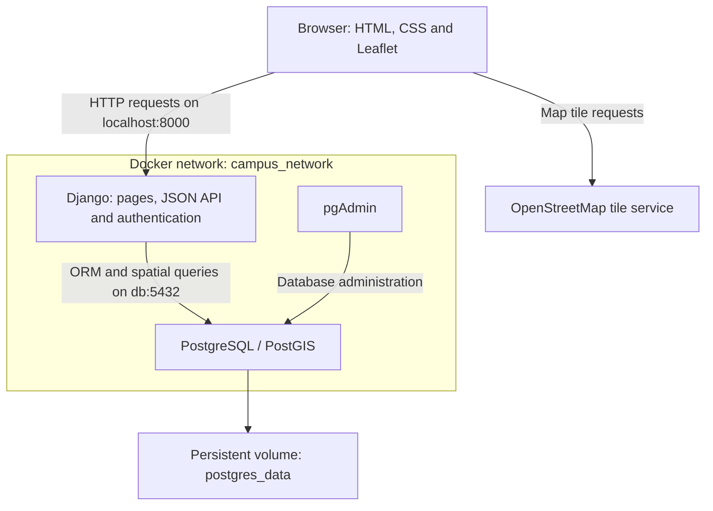
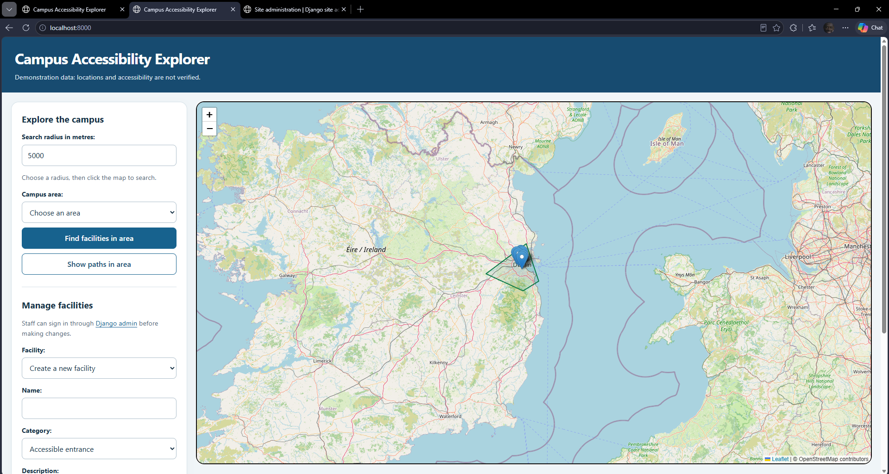
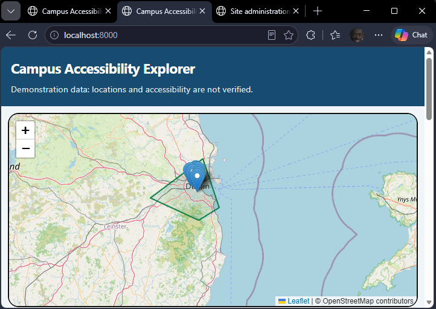

# Campus Accessibility Explorer

A local web-mapping application for exploring synthetic campus accessibility
data near Grangegorman, Dublin.

Built with Django, GeoDjango, PostgreSQL/PostGIS, Leaflet and Docker Compose.

## Demonstration data

All supplied facility locations, accessibility information, boundaries and paths
are synthetic and unverified. This application is a coursework demonstration,
not a verified accessibility or navigation service.

## Features

- Interactive map with facility markers and campus polygons.
- Search for nearby facilities within a radius measured in metres.
- Find facilities inside or on a selected campus area's boundary.
- Find paths intersecting a selected campus area.
- Create, read, update and delete facilities.
- Staff authentication and CSRF protection for facility changes.
- Responsive desktop and mobile layout.
- Repeatable demonstration-data command.
- Persistent PostgreSQL storage using a Docker named volume.

## Requirements

- Docker Desktop with Linux containers and Docker Compose.
- On Windows, a working WSL 2 backend.
- Git, if cloning the repository.
- Internet access for image builds, Leaflet assets and map tiles.
- Local ports 8000 and 5050 available.

The commands below run from the project root, alongside docker-compose.yaml.

## Installation

### 1. Configure environment variables

Copy .env.example to .env.

PowerShell:

```powershell
Copy-Item .env.example .env
```

Linux or macOS:

```bash
cp .env.example .env
```

Edit .env and set all six variables:

- POSTGRES_DB
- POSTGRES_USER
- POSTGRES_PASSWORD
- PGADMIN_DEFAULT_EMAIL
- PGADMIN_DEFAULT_PASSWORD
- DJANGO_SECRET_KEY

Replace placeholder passwords and the secret key with your own local values.
Do not commit .env.

### 2. Build and start the services

Ensure the build file is named Dockerfile with a capital D.

```bash
docker compose config --quiet
docker compose up -d --build
docker compose ps
```

The database should become healthy and the web service should start.

### 3. Apply migrations

```bash
docker compose exec web python manage.py migrate
docker compose exec web python manage.py check
```

### 4. Load demonstration data

```bash
docker compose exec web python manage.py seed_demo
```

This creates or updates the following records:

- Grangegorman Demo Area
- Grangegorman Demo Entrance
- Grangegorman Demo Lift
- Grangegorman Demo Toilet
- Grangegorman Demo Parking
- Grangegorman Demo Path

Running the command again updates records with those names.
Renaming a record means a later run can recreate the original named record.

### 5. Create an administrator

```bash
docker compose exec web python manage.py createsuperuser
```

Choose your own username and password.

## Local addresses

| Service | Address |
| --- | --- |
| Application | http://localhost:8000/ |
| Django administration | http://localhost:8000/admin/ |
| pgAdmin | http://localhost:5050/ |

Sign in to pgAdmin using the credentials configured in .env.
To register the database server, use host db, port 5432, and the PostgreSQL
database credentials from .env.

## Using the application

### Nearby facilities

Enter a radius, then click the map to choose the search centre.
The permitted radius is greater than zero and at most 50,000 metres.
Results show facility names and distances.

For the demonstration dataset, try a 500-metre radius near the campus markers.

### Facilities in an area

Select Grangegorman Demo Area and click Find facilities in area.
On a database containing only the demonstration dataset, four facilities
should be returned.

### Paths intersecting an area

Select Grangegorman Demo Area and click Show paths in area.
The demonstration path should appear on the map.

### Facility CRUD

Sign in through Django admin as a staff user, then return to the application.
Refresh the application after signing in so the form receives a current
CSRF token.

- Create: choose Create a new facility, complete the fields and save.
- Read: select an existing facility to load its details.
- Update: change the selected facility's fields and save.
- Delete: select a facility, click Delete selected facility and confirm.

Latitude and longitude are entered separately.
GeoJSON coordinates and GeoDjango Point construction use longitude first.

Campus areas and paths can be managed through Django admin.

## Spatial data and queries

All geometry fields use SRID 4326.

| Model | Geometry | Field |
| --- | --- | --- |
| Facility | Point | location |
| CampusArea | Polygon | boundary |
| CampusPath | LineString | route |

GeoDjango geometry fields use spatial indexes by default.

| Query | Implementation |
| --- | --- |
| Proximity | location__distance_lte with a distance in metres |
| Containment, including the boundary | location__coveredby |
| Path and area intersection | route__intersects |

Nearby results are annotated with Distance and ordered by distance.

## API endpoints

| Method | Endpoint | Purpose |
| --- | --- | --- |
| GET | /api/facilities/ | Facility GeoJSON |
| GET | /api/facilities/nearby/?lat=53.355&lon=-6.278&radius=500 | Nearby facilities |
| GET | /api/facilities/<id>/ | One facility's details |
| POST | /api/facilities/create/ | Create a facility |
| PUT | /api/facilities/<id>/ | Update a facility |
| DELETE | /api/facilities/<id>/ | Delete a facility |
| GET | /api/areas/ | Campus-area GeoJSON |
| GET | /api/areas/<id>/facilities/ | Facilities covered by an area |
| GET | /api/areas/<id>/paths/ | Paths intersecting an area |

POST, PUT and DELETE require a staff session and a valid CSRF token.
Use IDs returned by the API; do not assume an area always has ID 1.

## Persistence

PostgreSQL stores its data in the postgres_data named volume.

Stop the installation while keeping its database:

```bash
docker compose down
```

Start it again:

```bash
docker compose up -d
```

Saved records should remain.

WARNING: docker compose down -v removes the project's named volumes,
including its database.

## Verification checklist

- Django system check completes without errors.
- All three campus migrations are applied.
- The demonstration command can run twice without creating duplicate named records.
- The three spatial searches return the expected demonstration results.
- Staff can create, read, update and delete a temporary facility.
- Unauthenticated users cannot create, update or delete facilities.
- The layout is usable at desktop and mobile widths.
- A saved facility remains after containers are removed and recreated.
- A clean checkout can be installed using these instructions.

Check migrations with:

```bash
docker compose exec web python manage.py showmigrations campus
docker compose exec web python manage.py makemigrations --check --dry-run
```

## Troubleshooting

Inspect service state and recent logs:

```bash
docker compose ps
docker compose logs --tail=100 web db
```

If database tables are missing, run migrate.

If writes are rejected, check that you are signed in as staff and refresh
the application before retrying.

The Compose configuration uses a fixed network subnet and fixed host ports.
Stop other copies of this project before starting a separate installation.

Changing POSTGRES_USER or POSTGRES_PASSWORD in .env does not automatically
change credentials in an existing PostgreSQL database volume.

## Limitations

- Synthetic demonstration data is not suitable for real navigation.
- Paths are sample geometries, not computed accessible routes.
- Map tiles and Leaflet assets require external services.
- The current Docker setup uses Django's development server and DEBUG=True.
  It is intended for local coursework demonstration, not public deployment.


## Architecture



The browser renders the interface and requests spatial data from Django.
Leaflet retrieves basemap tiles directly from OpenStreetMap.

Docker Compose runs Django, PostGIS and pgAdmin as separate services on
a custom network. PostgreSQL data is stored in a named volume so it
survives container removal and recreation.

### Django application structure

The application follows Django's model–template–view pattern:

- Models: Facility, CampusArea and CampusPath define stored spatial data.
- Views: Python functions validate requests, run queries and return HTML or JSON.
- Templates: campus/map.html provides the interface and browser interactions.
- URL configuration: maps request paths to view functions.

Django views perform the request-handling role associated with controllers
in MVC terminology.

## Database schema

Each model has an automatically generated BigAutoField primary key named id.

| Model | Field | Type | Constraints |
| --- | --- | --- | --- |
| Facility | name | CharField | Maximum 100 characters |
| Facility | category | CharField | Maximum 20 characters; predefined choices |
| Facility | description | TextField | May be blank |
| Facility | location | PointField | SRID 4326; spatial index |
| CampusArea | name | CharField | Maximum 100 characters |
| CampusArea | description | TextField | May be blank |
| CampusArea | boundary | PolygonField | SRID 4326; spatial index |
| CampusPath | name | CharField | Maximum 100 characters |
| CampusPath | description | TextField | May be blank |
| CampusPath | route | LineStringField | SRID 4326; spatial index |

Facility category values are entrance, lift, toilet, parking and other.
The API validates category choices, required names and coordinate ranges.

There are no foreign keys between these three models. Spatial relationships
are calculated using geometry queries:

- Proximity: facilities within a requested distance of a point.
- Containment: facilities inside or on an area's boundary.
- Intersection: paths sharing any portion or point with an area.

Spatial indexes are created by the GeoDjango geometry fields, which have
spatial indexing enabled by default.

## Local deployment configuration

DJANGO_DEBUG and DJANGO_ALLOWED_HOSTS are passed to Django through
Docker Compose environment variables.

The demonstrated local configuration uses DJANGO_DEBUG=True and Django's
development server. It is not a production deployment.

A public deployment would additionally require a production application
server, static-file serving, DEBUG=False, appropriate host configuration,
HTTPS and secure session/CSRF cookies.

## Screenshots

### Desktop


### Mobile


## Attribution

Map display: Leaflet.
Basemap data: © OpenStreetMap contributors.